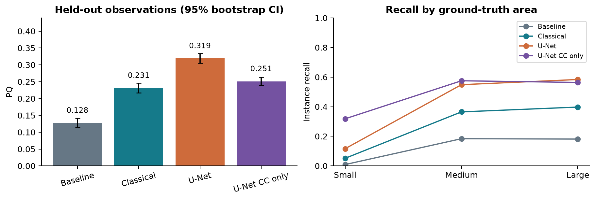

# filament-pq

**How Far Can Classical Image Processing Go? Solar Filament Instance Segmentation Measured Against Inter-Annotator Agreement**

CS543 / ECE549 Computer Vision, Fall 2026. 从零实现的太阳暗条实例分割研究：经典图像处理、U-Net、多人标注评估和可复现实验。

## Measured progress

On the frozen 287-observation main test split:

- Untuned classical baseline: **PQ 0.1278**.
- Tuned classical pipeline: **PQ 0.2314**.
- 512-pixel ResNet34 U-Net with validation-selected post-processing: **PQ 0.3194**.
- 1024-pixel L1, three seeds: **PQ 0.3522 ± 0.0037** (mean ± sample standard deviation).

E1-E4, objective E5, E7a, all six classical E6 folds and three L1 E7b seeds are complete.
clDice and site-held-out U-Net runs are deferred while work returns to classical
candidate/filtering diagnosis. Two anonymous 100-instance human-review
packages are ready locally. Human labels and team contributions remain pending.

在同一测试集上，经典调参和 U-Net 均提高了 PQ。消融显示背景校正贡献最大，
形状过滤没有明确收益。1024 的三种子 L1 对照已完成，训练队列已停止。
所有负面结果保留，测试结果不用于重新挑参数。

A controlled filtering-order follow-up is also complete: the frozen exploratory
test result is PQ **0.2313**, versus **0.2314** originally. It does not establish
an improvement, so the original method remains primary. See the
[experiment and negative-result analysis](docs/CLASSICAL_ORDER_EXPERIMENT.md).

See [measured results and uncertainty](docs/RESULTS.md),
[experiment/resumption commands](docs/RUNNING_EXPERIMENTS.md),
[original plan](docs/CS543_plan.md) and [proposal](docs/CS543_proposal.md).
The plan's early feasibility scores are historical, not the formal results above.



## Data and evaluation

MAGFiLO v1.0 contains 958 distinct 2048-pixel GONG observations, 1,593 annotation
sets and 10,244 instances. All data are downloaded with checksums; 154 empty
annotation sets are retained. Splits group every annotation of one photograph:
671 tune / 287 test, with 606 train / 65 validation inside tune (seed 543).

Predictions are scored separately against each annotator. Counts are pooled for
PQ/SQ/RQ and foreground Dice; 1,000 bootstrap draws resample whole observations.
Strict IoU > 0.5 matches the organizer's scorer exactly on 20 tune images plus an
empty-set fixture. Human comparisons use identical images and reference sets;
inter-annotator PQ is not a mathematical performance ceiling.

Classical M0-M6 includes solar-disk masking, background normalization, smoothing,
threshold/hysteresis/Frangi extraction, morphology and shape filtering, component
merging/conservative watershed, and boundary expansion. The learned foreground
uses the same post-processing implementation, with its own validation-selected
parameters. E7b adds soft-clDice; E6 retrains/retunes with one site excluded.

## Quick start

Python 3.11+; tested locally on Windows / Python 3.12. Run from the repository root.

```powershell
python -m venv .venv
.\.venv\Scripts\python.exe -m pip install -e ".[dev]"
.\.venv\Scripts\python.exe -m scripts.prepare_data --download-images
.\.venv\Scripts\python.exe -m pytest -q
.\.venv\Scripts\python.exe -m scripts.run_experiment --config configs/baseline.yaml --out results/baseline_tune --partition tune
```

On Linux/macOS use `.venv/bin/python`. The downloader obtains approximately 61 MB
of annotations and 606 MB of images from their public sources, verifies dimensions
and SHA256, and skips completed downloads. `data_manifest.json` records every image.

The local GPU is an RTX 4060 Laptop with 8 GB memory, using Torch 2.11.0 / CUDA 12.8.
Install a suitable official Torch build, then the optional dependencies:

```powershell
.\.venv\Scripts\python.exe -m pip install -e ".[dev,unet,report]"
# Run these in separate terminals; use the same commands after interruption.
.\.venv\Scripts\python.exe -m scripts.complete_study --phase classic --extensions
.\.venv\Scripts\python.exe -m scripts.complete_study --phase learned --extensions
```

Do not run duplicate copies of a queue. Training saves optimizer/scaler/RNG state;
evaluation saves per-observation checkpoints. Completed test configurations are
recorded and reused, not evaluated repeatedly. A sleeping or powered-off machine
cannot continue local computation. See [full instructions](docs/RUNNING_EXPERIMENTS.md)
for hardware setup, CPU timing, blind review and report generation.

## Outputs and reproducibility

- `filament/`: data, masks, M0-M6, metrics, visualization and U-Net.
- `scripts/`: downloading, search, training, evaluation, review and reporting.
- `configs/`: fixed recipes and frozen selected configurations.
- `splits/`: main and six site holdouts, bound to the annotation checksum.
- `tests/`: synthetic metric, pipeline, data-isolation and resumption checks.
- `docs/evidence/`: aggregate results and provenance suitable for Git.
- `data/`, `cache/`, `results/`, `output/`: local data, weights and artifacts; ignored by Git.

Local verification: **33 tests pass**; Windows/Linux core CI passes. CUDA training,
checkpoint resumption and official scorer agreement were also exercised.
`requirements-tested.txt` records the local environment, including optional GPU
and reporting packages. Raw runs save configuration, code/package/checkpoint
hashes, split IDs, per-image comparisons, predictions, metrics and overlays.

```powershell
.\.venv\Scripts\python.exe -m scripts.analyze_results
.\.venv\Scripts\python.exe -m scripts.build_report
.\.venv\Scripts\python.exe -m scripts.package_submission
```

The analyzer requires complete E3 curves by default; `--allow-incomplete` makes an
explicitly marked draft. The source-only submission ZIP contains `filament/`,
`scripts/` and `configs/`, as specified in the plan. Human-review CSVs are validated
and summarized separately; the software never supplies human ratings.

## Data and code attribution

MAGFiLO: Ahmadzadeh et al., [Scientific Data (2024)](https://doi.org/10.1038/s41597-024-03876-y),
[Harvard Dataverse](https://doi.org/10.7910/DVN/J6JNVK), **CC BY-NC 4.0**.
Images: NSO/AURA/NSF/[GONG](https://gong2.nso.edu/HA/hag/), CC BY 4.0.
Raw data and model weights are downloaded locally rather than committed to Git.

External code: the [organizer's evaluator](https://www.kaggle.com/code/azimahmadzadeh/self-evaluation-notebook),
[segmentation-models-pytorch](https://github.com/qubvel-org/segmentation_models.pytorch),
and [clDice](https://github.com/jocpae/clDice). The adapted clDice MIT notice is
included in [THIRD_PARTY_NOTICES.md](THIRD_PARTY_NOTICES.md) and the source ZIP.
Additional references and protocol limitations are recorded in the plan and report.
